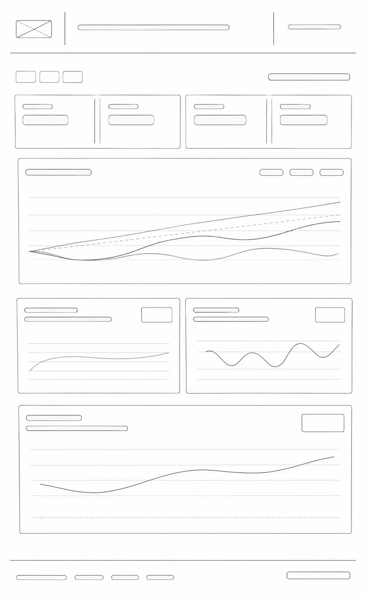
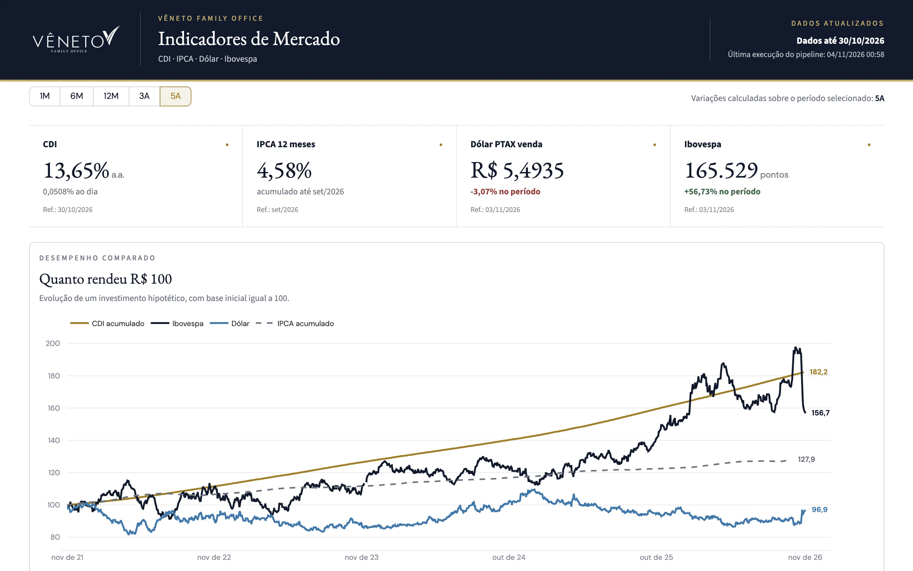
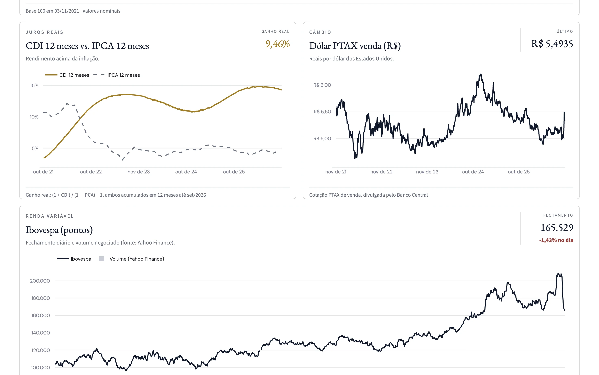
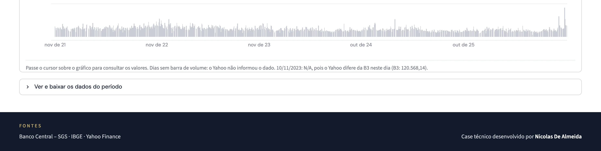

# Pipeline de indicadores de mercado — Vêneto Family Office

Pipeline ETL que coleta **CDI, IPCA, dólar PTAX e Ibovespa** dos últimos 5 anos, grava em um banco SQLite e exibe tudo em um dashboard interativo (Streamlit + Plotly).

## Wireframe do dashboard



### Como ficou o dashboard

Capturas de tela do dashboard pronto:







## O que o projeto faz

1. **Extract** — baixa as séries do Banco Central (API do SGS) e o Ibovespa do Yahoo Finance (`yfinance`).
2. **Transform** — converte tipos e datas, remove duplicatas, trata fuso horário e volume ausente, e marca dias especiais (dia parcial e dia divergente da B3).
3. **Load** — grava no SQLite, uma tabela por série, de forma idempotente (rodar de novo não duplica).
4. **Dashboard** — cartões, gráficos e tabela dos dados, com seletor de período (1M, 6M, 12M, 3A, 5A).

| Série | Fonte | Código / ticker | Frequência |
|---|---|---|---|
| CDI (% ao dia) | BCB / SGS | 12 | diária |
| IPCA (% ao mês) | BCB / SGS | 433 | mensal |
| Dólar PTAX venda (R$/US$) | BCB / SGS | 1 | diária |
| Ibovespa (fechamento e volume) | Yahoo Finance | `^BVSP` | diária |

## Como rodar do zero

### Testado no macOS com Python 3.13.0.

```bash
git clone https://github.com/Nicolas-De-Almeida/Veneto-pipeline-indicadores-mercado.git
cd Veneto-pipeline-indicadores-mercado
python3 -m venv .venv
source .venv/bin/activate
pip install -r requirements.txt
python3 -m src.pipeline
streamlit run dashboard/app.py
```

- `python3 -m src.pipeline` cria a pasta `data/` e o banco `data/mercado.db` (o banco não vai para o Git).
- O dashboard abre em http://localhost:8501.
- Para rodar os testes: `python3 -m pytest -q`.

### No Windows (não testado)

> ⚠️ Os comandos abaixo **não foram testados**. O projeto foi desenvolvido e testado apenas no macOS. As diferenças em relação ao Mac são o nome do comando do Python e a forma de ativar o ambiente virtual.

No PowerShell:

```powershell
git clone https://github.com/Nicolas-De-Almeida/Veneto-pipeline-indicadores-mercado.git
cd Veneto-pipeline-indicadores-mercado
python -m venv .venv
.venv\Scripts\Activate.ps1
pip install -r requirements.txt
python -m src.pipeline
streamlit run dashboard/app.py
```

- Se o PowerShell recusar o `Activate.ps1` com uma mensagem sobre "execução de scripts desabilitada", rode `Set-ExecutionPolicy -Scope Process -ExecutionPolicy Bypass` e tente de novo. Isso vale só para essa janela.
- No Prompt de Comando (cmd), a ativação é `.venv\Scripts\activate.bat`.
- Se `python` não for encontrado, tente `py` no lugar (`py -m venv .venv`, `py -m src.pipeline`).
- Os testes rodam com `python -m pytest -q`.

### Atualização incremental (bônus)

Por padrão o pipeline é **incremental**: para cada tabela ele lê a última data gravada e baixa só dali para a frente, começando **30 dias antes** (`MARGEM_INCREMENTAL_DIAS` em `src/config.py`). A margem corrige o Ibovespa que foi gravado como "parcial" (pregão aberto) e eventuais revisões da fonte. Como a gravação é `INSERT OR REPLACE`, baixar dias repetidos atualiza e não duplica.

- Banco vazio: baixa o histórico inteiro.
- `python3 -m src.pipeline --completo`: ignora o banco e baixa tudo de novo.

## Estrutura

```
src/
  config.py            parâmetros (séries, anos, margem incremental, dias divergentes)
  extract_sgs.py       download das séries do BCB, com repetição em caso de falha
  extract_ibovespa.py  download do Ibovespa pelo yfinance
  transform.py         limpeza e tipos
  indicadores.py       cálculos financeiros (CDI anualizado, IPCA 12m, ganho real, base 100)
  load.py              SQLite: criar tabelas, gravar, ler
  pipeline.py          orquestra extract -> transform -> load
dashboard/
  app.py               tela (Streamlit)
  dados.py             monta cartões, tabelas e séries do período
  graficos.py          figuras Plotly
  componentes.py       cabeçalho, cartões e rodapé em HTML
  tema.py              cores e CSS (paleta Vêneto ;)
  formatos.py          números e datas no padrão brasileiro
scripts/
  validar_ptax.py      confere o dólar do SGS com a API oficial da PTAX
  validar_ibovespa.py  confere o Ibovespa do Yahoo com a série histórica da B3
tests/                 testes automatizados (pytest)
```

## Decisões de projeto

- **Pipeline "tudo ou nada".** Primeiro baixa e limpa todas as fontes; só depois grava. Se uma fonte falhar, nada é gravado e o banco não fica com dados pela metade. O programa sai com código 1 e explica o motivo.
- **O banco guarda os valores originais.** Cada série mantém as suas datas reais, sem repetir valores. O preenchimento de dias sem dado (forward fill) acontece só ao montar o gráfico, e nunca depois da última data real de uma série.
- **Juros compostos, nunca soma.** CDI anualizado = (1 + d)^252 − 1. IPCA 12 meses = ∏(1 + mês) − 1. Ganho real = (1 + CDI 12m) / (1 + IPCA 12m) − 1, sobre os **mesmos** 12 meses.
- **Um ano extra para CDI e IPCA.** Esses dois baixam 6 anos para que os acumulados de 12 meses já estejam completos no início da janela de 5 anos.
- **Base 100 no gráfico comparativo.** As séries partem de 100 na primeira data em que todas têm dado, para comparar variações. O IPCA aparece como índice acumulado, com pontos no fim de cada mês.
- **Ibovespa parcial.** O dia de hoje, com o pregão aberto, aparece no cartão como "parcial hh:mm" e nunca nos gráficos. No banco fica marcado na coluna `parcial` e é substituído pelo fechamento na execução seguinte.
- **"Dados até" no cabeçalho** é a data mais antiga entre as últimas de CDI, dólar e Ibovespa fechado. Cada cartão mostra a própria data de referência ("Ref.").
- **Dia divergente da B3 vira N/A nos gráficos.** Em 10/11/2023 o Yahoo difere da B3 (fechamento B3: 120.568,14). O dia fica marcado no banco (`divergente`), aparece como N/A nos gráficos e a tabela mostra o valor da B3 para consulta.
- **Volume ausente.** O Yahoo informa volume 0 em alguns dias sem dado. Isso é gravado como NULL e aparece como N/A no dashboard (rótulo "Volume (Yahoo Finance)").
- **Datas em texto `AAAA-MM-DD` no SQLite.** É o formato que o SQLite ordena corretamente.
- **Formatação brasileira feita à mão** (1.234,56 e dd/mm/aaaa), sem depender do idioma instalado no computador.

## Validação dos dados

- **Dólar:** o SGS (série 1) foi comparado com a API oficial da PTAX (`scripts/validar_ptax.py`).
- **Ibovespa:** os fechamentos do Yahoo foram comparados com a série histórica do site da B3 em uma amostra de datas (`scripts/validar_ibovespa.py`), incluindo os dias de volume zero. A única divergência encontrada e checada manualmente foi 10/11/2023.
- **CDI e IPCA:** vêm direto do SGS (fontes Cetip/B3 e IBGE).

A validação do Ibovespa é por amostragem, não cobre todos os dias.

## Limitações

- **`yfinance` não é uma API oficial.** Ela raspa o Yahoo Finance, que pode mudar ou falhar. O pipeline repete a chamada e falha com mensagem clara. Com o pandas 3, a biblioteca emite avisos de depreciação (`Pandas4Warning`), que não afetam o resultado.
- **O Yahoo arredonda alguns fechamentos** e informa volume 0 em dias sem dado.
- **O CDI sai com um dia útil de atraso** e o IPCA é mensal, então o dado mais recente de cada cartão pode ter datas diferentes.
- **Período "5A" é o que o pipeline baixou** (5 anos), não um histórico maior.
- **Aproximação do IPCA no gráfico:** o índice acumulado usa pontos no fim de cada mês, não valores diários.
- **A validação do Ibovespa é amostral** (veja acima).
- Testado em macOS; não foi testado em Windows ou Linux.

## Testes

Os testes ficam em `tests/` e rodam com `python3 -m pytest -q` (136 testes). Eles cobrem a extração (com falhas simuladas), a transformação, os cálculos financeiros, o SQLite (em memória), o pipeline completo e incremental, e a montagem dos dados do dashboard. Nenhum teste acessa a internet.

## Uso de IA

Este projeto foi desenvolvido com a ajuda do **Claude (Anthropic)**, usado como assistente de programação em uma única conversa. Eu defini os requisitos e as decisões, li e conferi cada arquivo, rodei os testes e testei o dashboard. A conversa completa, com o prompt do case e a resposta, está em [`IA.md`](IA.md).