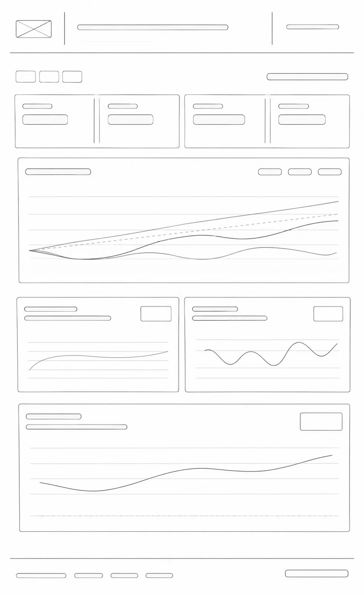

# Pipeline de Indicadores de Mercado

Pipeline de dados (ETL) com indicadores do mercado financeiro brasileiro
(CDI, IPCA, dólar PTAX e Ibovespa) e um dashboard para apoiar a equipe comercial.

> 🚧 Projeto em construção. 🚧 

---

## Layout do dashboard

---

## Decisões tomadas

### Validação dos códigos das séries (SGS)

O case não informa os códigos das séries do Banco Central. Cada código foi
pesquisado, e **conferido antes de implementado**, no site do SGS
(nome, periodicidade, unidade e fonte) e por valor, contra outras fontes.

| Indicador | Código | Nome no SGS | Periodicidade | Unidade | Fonte |
|---|---|---|---|---|---|
| CDI | 12 | Interest rate - CDI | Diária | % ao dia | Cetip (hoje B3) |
| IPCA | 433 | Broad National Consumer Price Index (IPCA) | Mensal | Variação % mensal | IBGE |
| Dólar (venda) | 1 | Exchange rate - Free - United States dollar (sale) | Diária | R$ por US$ | Sisbacen PTAX800 |

**Conferência por valor**

- **CDI (12):** o valor diário de 28/10/2026 (0,050788% ao dia), anualizado em
  252 dias úteis, dá 13,65% ao ano, igual ao da série 4389 do SGS na mesma data.
- **IPCA (433):** o acumulado em 12 meses (out/2025 a set/2026), calculado por
  composição dos valores mensais, dá 4,58%, igual ao da série 13522 do SGS e
  ao divulgado pelo IBGE.
- **Dólar (1):** os metadados da série descrevem a metodologia da PTAX, e os
  valores são idênticos aos da API oficial da PTAX do Banco Central em três
  datas (26/10/2026, 15/03/2023 e 04/08/2025). O script
  `scripts/validar_ptax.py` reproduz essa conferência. Ela é por amostragem
  (3 dias), não cobre os 5 anos inteiros.

As séries 4389 (CDI anualizado, base 252, em % ao ano, fonte BCB-Demab) e 13522
(IPCA acumulado em 12 meses, fonte IBGE) servem só para conferência e não entram
no pipeline.

**O que a API mostrou na prática (e como o pipeline lida com isso)**

- Os valores chegam como **texto** e as datas como `dd/mm/aaaa`; ambos são
  convertidos na etapa de transformação.
- O CDI é uma **taxa diária** e o IPCA é uma **variação mensal**: acumulados
  são calculados por composição (multiplicando `1 + taxa`), nunca somando.
- O IPCA vem com a data do **primeiro dia do mês de referência**.
- O dado mais recente é o do **dia útil anterior**.
- A API às vezes demora a responder (houve timeout no desenvolvimento), por
  isso a extração tenta novamente até 3 vezes.
- A API recusa janelas de consulta maiores que 10 anos.
- A API passou a recusar consultas em que a data final é igual à inicial
  (HTTP 400, "DataFinal deve ser maior que dataInicial"), comportamento que era
  diferente dias antes. O problema foi detectado pelo script de validação, rodando
  contra a API real; os testes unitários, que usam respostas simuladas, não o
  detectariam. O extrator agora valida as datas antes de chamar a API e não
  repete pedidos recusados com erro 4xx (só repete falhas de rede, timeout, erro
  5xx e resposta inválida).
